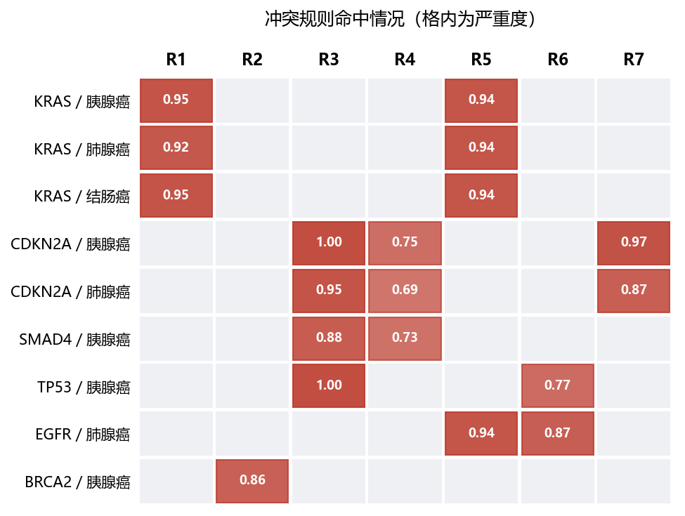
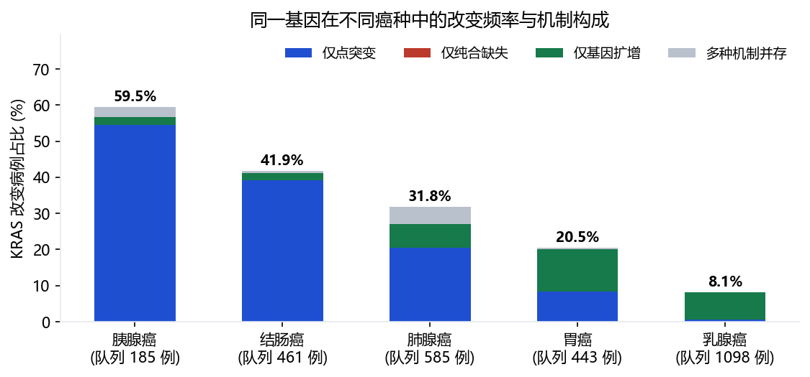
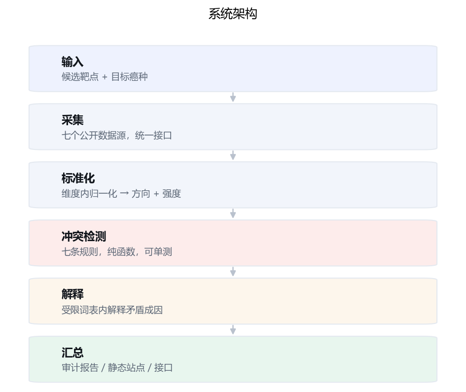

# 靶点尽调

**面向肿瘤靶点决策的证据冲突审计系统**

> 抗肿瘤药物从临床前到获批的整体失败率长期超过 90%，相当一部分并非倒在化合物优化，
> 而是倒在靶点选错。**靶点尽调对候选靶点做一次自动化尽调**：从七个公开数据源汇集证据，
> 把互相矛盾的地方自动揪出来并解释成因，给出治疗窗判断。
>
> 每条结论都可回溯至原始数据源。全部数据公开，不需要伦理审批。


### 想直接试试？

> **不想装任何东西** → 打开[在线工作台](https://litchidzx.github.io/target-audit/)，
> 左侧点任意靶点即可。
>
> **想要桌面版** → 从 [Releases](https://github.com/litchidzx/target-audit/releases/latest)
> 下载 `target-audit-windows-x64.zip`，解压后双击 `target-audit.exe`，
> 浏览器会自动打开。**不需要安装 Python。**
>
> **要审计自己的靶点** → 见下方快速开始的方式二或方式四。

## 怎么用

| 方式 | 命令 / 链接 | 需要什么 |
|---|---|---|
| **在线工作台** | <https://litchidzx.github.io/target-audit/> | 只要浏览器 |
| **魔搭创空间** | <https://www.modelscope.cn/studios/litchidzx/target-audit> | 只要浏览器（国内访问更快） |
| **桌面版（免安装）** | [从 Releases 下载](https://github.com/litchidzx/target-audit/releases/latest) | Windows，什么都不用装 |
| **桌面版命令行** | `target-audit.exe audit KRAS --cancer PAAD --out report.md` | 从 Releases 下载 |
| **本地网页界面** | `python run_web.py` → <http://127.0.0.1:8000> | Python 3.10+，可审计任意基因 |
| **本地跑一个靶点** | `python run.py audit KRAS --cancer LUAD` | Python 3.10+ |
| **只审计一个亚型** | `python run.py audit KRAS --cancer PAAD --variant G12D` | Python 3.10+ |
| **离线查看已有结果** | 下载仓库后双击 `docs/index.html` | 什么都不用装 |

**几种方式的分工**：两个在线站点是同一套静态文件的双地部署，**只能看已算好的靶点**；
桌面版、本地网页界面与命令行**能审计任意基因**。全都不需要注册。

**想直接看亚型分析**：打开任一在线站点或桌面版，点开 KRAS / 胰腺癌，
结果页里有一节「亚型分析」。

---

## 快速开始

### 方式一：在线工作台（零安装）

打开 <https://litchidzx.github.io/target-audit/> 或
<https://www.modelscope.cn/studios/litchidzx/target-audit>，
左侧挑一个靶点，或直接搜 `KRAS`。
用癌种和规则标签筛选，例如只看 `R1` 治疗窗狭窄命中的靶点。

操作步骤：

1. 左侧列表按癌种分组，点标题可以折叠；顶部搜索框按基因符号过滤
2. 点任意一个靶点，右侧展开这一靶点的审计卡片
3. 卡片内依次是结论、冲突清单、七个维度的证据矩阵、亚型分析与数据来源
4. 每条证据后面都标了出处，可以直接点回原始数据库

放在本地也能用：下载仓库后双击 `docs/index.html`。页面不依赖网络，
所有结果在构建时已经算好并固化。

> **注意工作台里能搜什么。** 搜索框只在已审计的靶点里筛选，**不能审计新基因**。
> 要跑一个新靶点，用下面方式二。

### 方式二：本地审计任意靶点（约两分钟）

工作台只能看已算好的结果。**要审计一个新靶点，在本地运行**：

```bash
git clone https://github.com/litchidzx/target-audit.git
cd target-audit

python run.py doctor        # 先看看环境差什么，它会逐项说明
python run.py self-test     # 37 项测试，不需要网络
python run_web.py           # 起一个网页界面，浏览器打开 127.0.0.1:8000
```

网页界面里输入基因符号与癌种，服务端实时跑审计。也可以走命令行：

```bash
python run.py audit KRAS --cancer LUAD                  # 首次约 30-45 秒，之后走缓存
python run.py audit KRAS --cancer PAAD --variant G12D   # 只看这一个亚型
python run.py audit KRAS --cancer PAAD --no-variants    # 跳过亚型分析，更快
```

#### 网页界面的操作步骤

打开 <http://127.0.0.1:8000> 后：

1. **基因符号**填 `KRAS`
2. **目标癌种**下拉里选「胰腺癌（PAAD）」
3. **亚型（可选）**这一栏会自动弹出该基因在该癌种里的实际变异列表
   （如 `G12D`、`G12V`、`G12R`… 后面标着病例数）。
   可以直接从列表里挑，也可以**自己输入**一个罕见位点，比如 `Q61H`。
   **留空则做基因级审计**，同时仍然给出变异谱与覆盖缺口判断。
4. 点「开始审计」，等半分钟左右出结果。

结果页里除了原有的冲突清单与证据矩阵，还有一节「亚型分析」，
列出各变异的占比与获批药物情况，以及覆盖率。

> 界面上会明确写出**哪些维度能亚型化、哪些不能** ——
> DepMap 敲的是整个基因，与具体位点无关，所以肿瘤依赖性不会因为换了亚型而改变。

### 首次运行会遇到什么

这套东西刻意做成**缺什么都能跑**，不会因为少一个数据源就崩：

| 能力 | 依赖 | 开箱可用？ |
|---|---|---|
| 引擎、七条冲突规则、解释层兜底 | 无 | ✅ 不需要网络 |
| gnomAD 人类遗传学耐受性 | 4.6MB 约束表 | ✅ 首次使用时自动下载 |
| 临床相关性、正常组织暴露、成药性、在靶毒性 | 四个公开接口 | ✅ 需要联网 |
| 亚型分析（变异谱 + 亚型成药） | cBioPortal + openFDA 说明书 | ✅ 需要联网 |
| 肿瘤依赖性、跨癌种选择性 | DepMap 约 400MB | ⚠️ 需手动下载，见下文 |

> 桌面版已内置紧凑版 DepMap 矩阵（13.8MB），所以**下载即七个维度齐全**；
> 源码方式需要自行准备，见第八节。

**缺任何一项都只会让对应维度标记为"证据不足"，其余维度照常工作。**
覆盖不足 5/7 个维度时，系统会明确说明"证据不足，不足以支撑任何结论"，
而不是给一个没有依据的正面判断。

### 方式三：Docker

```bash
docker build -t target-audit .
docker run --rm target-audit audit KRAS --cancer LUAD --mock
```

### 方式四：下载可执行程序（Windows，不需要装 Python）

从 [Releases](https://github.com/litchidzx/target-audit/releases/latest)
下载 `target-audit-windows-x64.zip`，解压到任意目录，**双击 `target-audit.exe`**。
程序在后台启动本地服务并自动打开应用窗口，**不会弹出命令行黑框**。

操作步骤：

1. 解压压缩包，双击 `target-audit.exe`
2. 首次启动约 3-5 秒，随后出现应用窗口（若窗口没自动出现，等几秒再双击一次，
   或双击同目录下的 `启动.cmd`）
3. 在窗口里填基因符号、选癌种，亚型一栏留空或从下拉列表里挑
4. 点「开始审计」，结果直接显示在同一窗口里

> **整个文件夹要一起保留。** exe 依赖同目录下的库文件与 `data/`，单独把
> `target-audit.exe` 拖到桌面会启动失败。想放桌面的话，右键 exe →
> 「发送到」→「桌面快捷方式」。

也可以在命令行里直接调用同一个程序，拿到 Markdown 报告：

```bash
target-audit.exe audit KRAS --cancer PAAD --variant G12D --out report.md
target-audit.exe self-test          # 37 项单元测试，不需要网络
target-audit.exe doctor             # 逐项检查环境，告诉你缺什么、怎么补
```

Python 是解释型语言，源码必须有解释器才能运行；打包版把解释器和依赖一起装了进去，
所以使用者不需要任何环境准备——这也是普通软件能双击运行的原因。

自己构建：

```bash
python scripts/build_exe.py            # 目录模式，产出压缩包
python scripts/build_exe.py --onefile  # 单文件 exe
```

打包脚本会把紧凑版 DepMap 矩阵（13.8MB）与 gnomAD 约束表（4.6MB）一并放进包里，
所以下载即七个维度齐全。若要换成更新版的官方数据，把 DepMap 文件放到
exe 旁边的 `data/depmap/` 覆盖即可。

### 环境要求

- Python 3.10 或更高（开发环境为 3.14）
- **无第三方运行时依赖**：不需要 numpy、pandas、requests，只用标准库
- 画图和生成站点需要 matplotlib（仅开发用，不是运行必需）

---

## 一、它解决什么问题

随着公共组学数据持续积累，单个候选靶点的可用证据在数量上已相当充足。
真正的困难在于，不同数据源经常给出方向相反的结论，而现有工作流缺乏对这类矛盾
进行系统识别、记录与解释的手段。

目前研究者的常规做法是在多个数据库之间分别检索、人工汇总成表、凭经验取舍。
这个过程有三方面问题：

1. **效率低**：完成一个靶点的多源证据整理通常需要数日；
2. **不可复现**：判断依赖个人经验，没有记录与复核机制；
3. **矛盾被掩盖**：人工汇总时方向相反的结论往往被平均化或选择性忽略，
   而这恰恰是最需要审慎对待的部分。

**靶点决策的失误，几乎从来不是缺证据，而是证据打架时判断错了。**

## 二、核心命题

不是"这个靶点重要吗"，而是"**这个靶点比它的替代选择重要多少**"。

决定成药性的是**选择性**，不是重要性。KRAS 的重要性无可争议，但四十年才做出药；
很多同样重要的靶点死在临床，恰恰是因为它们不够独特。选择性有两个半边，
系统的结构就按这两边组织：

- **肿瘤侧**：在目标癌种必需，在其他癌种不必需
- **正常侧**：在肿瘤中必需，在正常组织中不必需

## 三、七个证据维度

| 分组 | 维度 | 回答的问题 | 数据来源 |
|---|---|---|---|
| 肿瘤侧 | 肿瘤依赖性 | 在目标癌种模型中抑制它是否影响细胞存活 | DepMap（2554 细胞系 / 34 谱系） |
| 肿瘤侧 | 跨癌种选择性 | 这份依赖是否为目标癌种所特有 | DepMap |
| 临床侧 | 临床相关性 | 真实患者中的改变图谱与改变方式 | TCGA / GDC |
| 正常侧 | 正常组织暴露 | 正常组织与细胞类型的表达分布 | HPA |
| 正常侧 | 人类遗传学耐受性 | 人类功能缺失携带者的表型 | gnomAD |
| 正常侧 | 经验性在靶毒性 | 同靶点已上市药物的真实不良反应谱 | openFDA FAERS |
| 可做性 | 成药性 | 是否已有获批药物，走到了哪一阶段 | ChEMBL |

## 四、冲突检测规则

系统的核心输出不是分数，而是**冲突清单**。靶点决策的失败模式就那么几种，
能认出来就是专业判断。每条规则由一对相互矛盾的方向信号构成：

| 编号 | 冲突类型 | 冲突构成 |
|---|---|---|
| R1 | 治疗窗狭窄 | 肿瘤依赖性强 × 正常组织广泛暴露 |
| R2 | 缺乏独特性 | 肿瘤依赖性强 × 跨癌种不特异 |
| R3 | 表达与依赖脱节 | 临床证据强 × 肿瘤依赖性弱 |
| R4 | 重要但难成药 | 临床证据强 × 成药性弱 |
| R5 | 可成药但不安全 | 成药性强 × 在靶毒性风险高 |
| R6 | 遗传学脆弱 | 成药性强 × 人类功能缺失不耐受 |
| R7 | 缺失主导型改变 | 改变频率高 × 以缺失失活为主 |

不输出综合评分，是因为靶点决策需要的是取舍依据，而评分会把相互矛盾的信息
平均化，恰好掩盖决策所需的关键差异。

九个真实靶点上七条规则的命中情况（格内为严重度）：



## 五、亚型分析

**同一句"这个基因有获批药物"，在不同癌种里的含义可以差几十倍。** 因为药往往是
亚型特异的：KRAS 的获批抑制剂只打 G12C，而胰腺癌里主要是 G12D ——
"KRAS 有药"这句话，对胰腺癌患者基本用不上。

亚型分析把这层拆开。输入基因和癌种后，系统给出该癌种里实际发生的变异构成、
每个变异的获批药物情况，最后给出一个直接可用的数字：
**这个队列里有多大比例的变异，是现有获批药物覆盖得到的。**

实测结果：

| 靶点 / 癌种 | 覆盖率 | 说明 |
|---|---|---|
| BRAF / 结肠癌 | 73% | V600E 是主要改变，有多个获批药 |
| KRAS / 肺腺癌 | 41% | G12C 占 41%，有获批药 |
| EGFR / 肺腺癌 | 34% | L858R 有药；外显子 19 缺失需人工核对 |
| KRAS / 胰腺癌 | 0% | 主要改变 G12D 目前没有获批药 |
| TP53 / 胰腺癌 | 0% | 变异散落在各位置（最大仅占 4%），不存在单一用药可能 |

**它不是第八个维度，而是叠加在基因级审计之上的一层。** 有些维度可以亚型化，
有些不能，这个边界在界面上也写明，避免让人误以为选了亚型之后七个维度都变了。

可以亚型化的：**临床相关性**（变异谱本身就是它的一部分）、
**成药性**（按亚型查说明书，得到真实覆盖情况）。

不能亚型化的：**肿瘤依赖性、跨癌种选择性**（DepMap 敲的是整个基因，与具体位点无关）、
**正常组织暴露、人类遗传学耐受性**（本身就是基因级）。

### 三个必须处理的细节

**变异编号必须与文献一致。** GDC 按转录本注释，同一个变异会命中十几个转录本、
编号各不相同（实测一个 BRAF 变异被标成 A444Cfs*9 / A404Cfs*9 / A85Cfs*9 …），
而且它标记的"规范转录本"与社区通用写法不一致 —— BRAF 的 V600E 会写成 V640E。
编号一旦对不上，就查不到对应的药物。因此变异谱取自 cBioPortal，
它输出的是 V600E、G12D 这类通用写法。

**结构性变异不能用坐标检索。** 缺失、插入、移码在说明书里按外显子或区域描述，
例如奥希替尼写的是 "EGFR exon 19 deletions"，而不是 `E746_A750del`。
所以这类变异**查不到不等于没有药**，系统把它们标为"不适用"并排除出覆盖率分母，
避免给出错误结论。

**说明书只收录已获批药物。** 因此亚型分析回答的是"现在能不能用上药"，
不是"有没有人在研发"。临床阶段的候选药不会体现。

## 六、真实数据运行结果

九个靶点、七个公开数据源，**七条规则全部触发过**：

| 靶点 / 癌种 | 系统判断 | 触发的冲突 |
|---|---|---|
| KRAS / PAAD | 治疗窗待确认，安全边界待确认 | R1、R5 |
| KRAS / LUAD | 安全边界待确认，治疗窗待确认 | R5、R1 |
| KRAS / COAD | 治疗窗待确认，安全边界待确认 | R1、R5 |
| CDKN2A / PAAD | 模型体系存疑，需要换策略，成药路径不明 | R3、R7、R4 |
| CDKN2A / LUAD | 模型体系存疑，需要换策略，成药路径不明 | R3、R7、R4 |
| SMAD4 / PAAD | 模型体系存疑，成药路径不明 | R3、R4 |
| TP53 / PAAD | 模型体系存疑，抑制深度需严格控制 | R3、R6 |
| EGFR / LUAD | 安全边界待确认，抑制深度需严格控制 | R5、R6 |
| BRCA2 / PAAD | 选择性不足 | R2 |

其中 CDKN2A 一例最能说明系统的价值：该基因在患者数据中改变频率很高（临床证据强），
但在胰腺癌细胞系中敲除并不影响生长（依赖性弱）。系统据此检出 R3「表达与依赖脱节」，
指出需要先确认哪个模型体系可信 —— **这个矛盾在单看任一指标时都不会显现**。

系统同时支持跨癌种横向比较。同一个基因在不同癌种里的改变频率与机制构成可以差很多：



### 运行中发现并修正的问题

接入真实数据的过程暴露了几个只有跑真数据才会发现的问题，都已在代码注释中记录：

1. **只统计点突变会严重低估肿瘤抑制基因。** CDKN2A 在 TCGA-PAAD 中的
   点突变频率为 16.2%，而点突变 ∪ 纯合缺失 ∪ 扩增后为 40.0%。
   只看突变频率会得出"CDKN2A 在胰腺癌中不重要"这个完全错误的结论。

   

2. **ChEMBL 靶点匹配不能只靠名称。** `q=EGFR` 返回的前几条是蛋白互作靶点和
   小鼠 EGFR，真正的人源单蛋白条目根本不在前面，导致有奥希替尼等上市药的 EGFR
   被判成"无成药路径"。改为先解析人源 UniProt 登录号再按 accession 精确查。
3. **FAERS 上报总数不能取 count 查询的 total。** 那是聚合结果条数，实测得到 0，
   而 0 会被下游读成"没有不良反应"，与事实完全相反。
4. **分位方向不能想当然。** DepMap 的 gene effect 越负表示越依赖，
   与"分位越高越有利"的语义相反，不翻转会把强依赖基因判成不利。

## 七、技术架构

六层：输入 → 采集 → 标准化 → 冲突检测 → 解释 → 汇总



三条贯穿始终的设计约束：

1. **归一化只在维度内部做。** 表达量、半数抑制浓度、风险比量纲不同，
   跨维度直接比较无意义。所有原始值先在本维度内转百分位，再映射为方向与强度。
   方向的定义在整个系统中只有一处（`tsa/dimensions.py`）。
2. **规则层定位矛盾，解释层受限表达。** 冲突由纯函数规则检出，不依赖网络与模型，
   可独立测试。大语言模型只负责解释已检出的冲突，且解释范围限定在预定义的原因词表内。
   换模型不改变矛盾是否存在。
3. **全链路可溯源。** 每条证据都保留原始值与来源链接。

### 解释层不绑定任何模型服务商

提示词、校验、重试与降级逻辑都是通用的，换模型只改配置：

```bash
# 不启用解释层（只跑规则）
python run.py audit KRAS --cancer LUAD

# 确定性兜底，不需要任何凭据
python run.py audit KRAS --cancer LUAD --llm stub

# 换成任意一家
TSA_LLM_PROVIDER=deepseek TSA_LLM_MODEL=deepseek-chat TSA_LLM_API_KEY=sk-... \
  python run.py audit KRAS --cancer LUAD

# 本地模型也可以
TSA_LLM_PROVIDER=ollama TSA_LLM_MODEL=qwen3:8b python run.py audit KRAS --cancer LUAD
```

模型输出必须通过校验才会被采用：成因必须在受控词表内、必须引用存在的证据编号。
不过校验就重试一次，再不过就降级到规则层的候选原因。**任何情况下报告都是完整的，
不会出现没有依据的结论。**

## 八、DepMap 参考数据

肿瘤侧两个维度（肿瘤依赖性、跨癌种选择性）依赖 DepMap 的基因效应矩阵。
它不随仓库分发，需要单独下载约 400MB：
<https://depmap.org/portal/data_page/?tab=allData>

需要 `CRISPRGeneEffect.csv` 与 `Model.csv`，放到 `data/depmap/`。
文件名不必严格一致，系统会按模式忽略大小写匹配。

**缺少它时系统会降级为缺少这两个维度并明确标注，不会报错退出** ——
这是刻意的设计：七个数据源里挂掉两三个是常态，不该让整个审计失败。

## 九、工作台与静态站点

`docs/` 是构建产物，纯静态，可直接托管在 GitHub Pages。
审计结果在构建时算好并固化，**演示现场不依赖网络**，
也不会因为某个外部接口抽风而演示失败。

仓库自带的这一份收录 **35 个靶点、7 个癌种**，七条规则全部至少命中过一次。

重新生成：

```bash
python scripts/build_site.py --out docs          # 接真实数据
python scripts/build_site.py --out docs --mock   # 离线验证
TSA_OFFLINE=1 python scripts/build_site.py --out docs   # 只读缓存重放
node tests/web_smoke.mjs                         # 无浏览器环境下验证界面
```

## 十、边界与局限

本系统为面向科研的靶点证据整理工具，**不输出诊断、治疗或用药建议**。

- DepMap 只有癌细胞系，没有正常细胞，"正常细胞必需性"查不到，
  正常侧只能使用 HPA / gnomAD 这类代理信号；
- FAERS 是自发上报数据，**没有分母**，算不出发生率，且存在上报偏倚，
  无法区分药物引起和疾病本身的症状，只能作为信号线索；
- 部分维度的取值由分类变量映射到有序等级（HPA 的组织特异性、ChEMBL 的研发阶段），
  这是人为定义的序，报告中均已标明；
- 系统不重复建设证据聚合层，而是在既有基础设施之上构建判断层。

## 十一、目录结构

```
├── run.py                    命令行入口
├── run_web.py                本地网页界面（实时审计任意基因）
├── app_entry.py              打包入口：双击开界面，带子命令则走命令行
├── tsa/
│   ├── schema.py             统一证据模型
│   ├── dimensions.py         维度元数据（方向定义的唯一出处）
│   ├── normalize.py          百分位 -> 极性 + 强度
│   ├── conflicts.py          七条冲突检测规则
│   ├── engine.py             编排与判断
│   ├── explain.py            解释层：提示词、校验、重试、降级
│   ├── variants.py           亚型分析：变异谱、覆盖缺口、可亚型化边界
│   ├── report.py             Markdown 报告
│   ├── webexport.py          静态站点导出
│   ├── liveui.py             实时界面服务端渲染
│   ├── depmapbin.py          DepMap 矩阵的紧凑二进制读写
│   ├── paths.py              只读资源与可写数据的路径解析
│   ├── mock.py               离线假数据
│   ├── llm/                  模型接入层（不绑定服务商）
│   ├── webassets/            界面资源（HTML / CSS / JS / 图标）
│   └── connectors/           七个数据源 + 亚型数据源
│       ├── depmap.py         肿瘤依赖性与跨癌种选择性
│       ├── tcga.py           临床相关性
│       ├── hpa.py            正常组织暴露
│       ├── gnomad.py         人类遗传学耐受性
│       ├── chembl.py         成药性
│       ├── faers.py          经验性在靶毒性
│       ├── cbioportal.py     变异谱（亚型分析）
│       └── variant_drugs.py  亚型获批药物（说明书检索）
├── scripts/
│   ├── build_site.py         生成静态站点
│   ├── build_exe.py          打包可执行程序
│   ├── pack_depmap.py        DepMap CSV -> 紧凑二进制
│   ├── cross_cancer.py       跨癌种横向比较
│   ├── fetch_reference_data.py  参考数据下载
│   ├── make_figures.py / make_icon.py / make_bp_doc.py   图表、图标与文档
│   └── ...
├── tests/                    37 项单元测试
├── docs/                     GitHub Pages 站点（构建产物）
├── paper/                    项目书与商业计划书
└── examples/                 Markdown 示例报告
```

## 十二、数据来源

全部为公开数据，不涉及患者隐私，不需要伦理审批。

| 数据源 | 提供内容 |
|---|---|
| DepMap | 全基因组 CRISPR 敲除必需性 |
| TCGA / GDC | 体细胞突变、拷贝数改变、临床信息 |
| HPA | 正常组织与单细胞表达 |
| gnomAD | 人群遗传约束指标 |
| ChEMBL | 生物活性物质与靶点机制 |
| openFDA FAERS | 药品不良反应自发上报 |
| cBioPortal | 癌种特异的变异谱与病例数（亚型分析） |
| openFDA 药品说明书 | 已获批适应症，按亚型精确检索（亚型分析） |

---

## 许可

MIT License，见 [LICENSE](LICENSE)。
